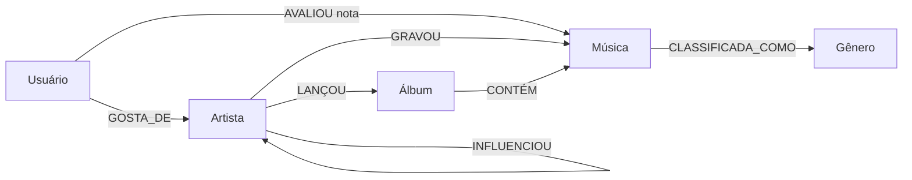

# estudo-neo4j

Grafo de estudo com **88 nós** e **196 relacionamentos**, espelhando o export APOC do seu Neo4j.

## Objetivo

Praticar Cypher com o modelo completo: usuários, artistas, músicas, álbuns, gêneros e todos os tipos de aresta do banco.

## Modelo do grafo



| Tipo | Qtd | Significado |
|------|-----|-------------|
| `AVALIOU` | 31 | Usuário → Música (`nota`) |
| `GOSTA_DE` | 52 | Usuário → Artista |
| `INFLUENCIOU` | 14 | Artista → Artista |
| `LANÇOU` | 24 | Artista → Álbum |
| `GRAVOU` | 25 | Artista → Música |
| `CLASSIFICADA_COMO` | 25 | Música → Gênero |
| `CONTÉM` | 25 | Álbum → Música |

Nós por label: 10 Usuário, 21 Artista, 25 Música, 24 Álbum, 8 Gênero.

## Como carregar

### Opção A — clone APOC (idêntico ao export)

```text
:play data.cypher
```

`data.cypher` inclui constraint `UNIQUE IMPORT`, carga por `_id`, cleanup e `DROP CONSTRAINT` no final.

### Opção B — scripts legíveis

1. `scripts/01_create_nodes.cypher` (zera o banco com `DETACH DELETE`)
2. `scripts/02_create_relationships.cypher` (196 arestas por `nome`)

Consultas de exemplo: `scripts/03_queries.cypher`.

Indicação de artistas (colaborativo, gênero, influência, híbrido): `scripts/04_recomendacao_artistas.cypher`.

## Regenerar a partir do export

O JSON completo dos 15 batches está em `apoc-export.json`. Para refazer `data.cypher` e `02_create_relationships.cypher`:

```bash
python3 scripts/fetch_apoc_json.py      # materializa apoc-export.json (fonte embutida)
python3 scripts/build_from_apoc_export.py
```

Validação rápida após carga:

```cypher
MATCH (n) RETURN count(n);          // 88
MATCH ()-[r]->() RETURN count(r);   // 196
```

## Tecnologias

- Neo4j 5.x
- Cypher
- APOC (`apoc.export.cypher.all`)

## Estrutura

```text
apoc-export.json          # 15 batches do stream APOC
data.cypher               # concatenação executável
scripts/
  01_create_nodes.cypher
  02_create_relationships.cypher   # gerado; 196 rels
  03_queries.cypher
  build_from_apoc_export.py
  fetch_apoc_json.py
README.md
```
